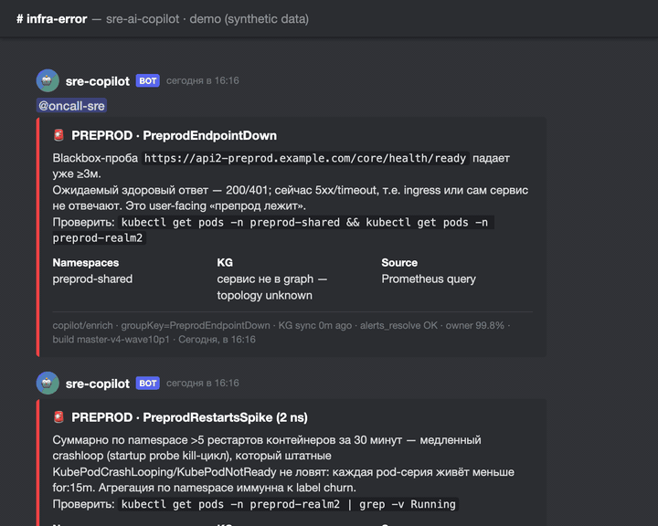

# SRE AI Copilot

[](LICENSE)
[](https://www.python.org/)
[](tests)
[](.github/workflows)
[](CHANGELOG.md)

**Homepage:** [sre.froggychips.xyz](https://sre.froggychips.xyz) · **Stack:** FastAPI + Celery + Postgres-KG + LLM + MCP

> **Let an AI run incident response for Kubernetes — without letting it touch prod on a hunch.** Whether to apply a `kubectl` fix is decided by a deterministic policy engine (8 risk axes), *not* taken from the model's answer — so the copilot is safe to put next to production. KG-first enrichment, multi-hypothesis RCA, controlled remediation, and honest about its own blind spots.

> **[English](#english) · [Русский](#русский)**



*Live output formats on synthetic data: user-facing endpoint-down critical with a `kubectl` hint, slow-crashloop catcher, deploy-regression enrichment with blast radius, KG upstream-cascade reasoning, resolved notice and the daily cluster digest. Source page: [docs/assets/demo-alerts.html](docs/assets/demo-alerts.html).*

---

<a name="english"></a>
## English

**SRE AI Copilot** is a backend service that turns Prometheus AlertManager webhooks into either an **advisory analysis** (default) or an **auto-remediation with human approval** (opt-in) of a Kubernetes incident — root cause + recommended actions, posted as a Discord embed.

> **Default = advisory mode.** With out-of-the-box settings (`EXECUTOR_ENABLED=false`, `EXECUTOR_APPROVAL_ENABLED=false`) the copilot does **not** call `kubectl` — it analyzes, posts to Discord, and stops. Engineer acts manually.
>
> **Opt-in = auto-remediator with approval.** Setting `EXECUTOR_ENABLED=true` adds a 9th pipeline stage that validates the proposed action against `kube-apiserver` via `kubectl ... --dry-run=server`. Setting `EXECUTOR_APPROVAL_ENABLED=true` additionally shows an «⚙️ Apply» button on the Discord embed (only when dry-run passed and risk ≤ medium); two-click confirmation → real `kubectl` under `K8sSecurityGuard` with full OTEL audit. See [Roadmap → Execution](#roadmap--execution) below for the ramp-up plan.

### What it does

- Receives AlertManager webhooks — three endpoints under `/webhooks/alertmanager`, see [Alert path](#alert-path-what-actually-runs) below.
- **Fingerprint deduplication**: skips re-running the pipeline for alerts already in-flight (OPEN → RESOLVED). Only FAILED incidents are retried.
- **Flapping detection**: if an alert fires after RESOLVED, increments `flap_count` and re-runs the pipeline with explicit context — "this alert has cycled N times; RESOLVED was likely premature."
- Runs `DiagnosticsEngine` — deterministic rules produce a typed `FactStore` (OOM killed, process crash, crashloop, …) before any LLM call.
- Detects **fact conflicts** (`oom_killed` + `process_crash` both true = contradiction → confidence capped, `<conflicts>` block injected into prompts).
- Runs a **multi-hypothesis fan-out** across 4 perspectives (app / infra / deps / runtime) filtered by `PERSPECTIVE_PRECONDITIONS`, then adversarially grounds each hypothesis against the `FactStore` via `FactCriticAgent`.
- Enriches context with **cluster-wide health snapshot** at incident time: nodes ready, pod failures, crashloops, CPU/mem/disk peak, firing alert counts — same metrics as the `#stats` daily report. Lets the LLM distinguish "isolated pod issue" from "cluster-wide pressure."
- Supports **Node\* alerts** (NodeDiskIOSaturation, NodeMemoryWillExhaustSoon, …): `instance`/`node` labels are used for enrichment and displayed in the Discord embed instead of `pod`.
- **Alert-quality noise suppression**: meta-aggregate alerts (`*NewCriticalAlerts`, control-plane scrape-gap derivatives) and *conditional* `KubeDeploymentGenerationMismatch` churn are rendered **muted** (grey + 🔇, no 🚨/@mention) rather than dropped — visible for eyeballing but never paging. `gen_mismatch_noise` is health-gated (muted only when `ready==desired`, LOUD otherwise); both classes have kill-switches. Distinct from the input-level `ALERT_SUPPRESS_NAMES` drop and from `rollout_noise` deploy-window suppression.
- Enriches context from **Atlassian Jira** (open/resolved tickets for the service), **TeamCity** (recent deploys), and **VictoriaMetrics** (memory/CPU window per pod + cluster health).
- Detects **recurrence**: same service resolved < 7 days → `FixAgent` switches to investigative mode (no restart recommendations).
- Posts a **single Discord embed** per incident (title + root cause + synthesis + feedback buttons), replacing the previous two-message flow.
- **👍 / 👎 feedback buttons** on every embed: 👍 saves immediately; 👎 requires a two-step confirmation ("Confirm: was the model's *analysis* wrong?") to prevent accidental negative feedback. Stored in `IncidentRecord.user_feedback`.
- **Structured `ExecutionIntent`** alongside prose: `FixAgent` emits JSON in the `ExecutionIntent` schema (`action`, `resource_type`, `resource_name`, `namespace`, `params`, `risk`); pydantic-validated, `FORBIDDEN_NAMESPACES` rejected at parse time, persisted to `IncidentRecord.analysis.execution_intent`.
- **Executor stage** (opt-in via `EXECUTOR_ENABLED=true`): server-side dry-run of the intent (`kubectl ... --dry-run=server`) under `K8sSecurityGuard`; result captured in `executor_result` and shown as a "Dry-run verdict" field on the Discord embed.
- **Discord Apply button** (opt-in via `EXECUTOR_APPROVAL_ENABLED=true`): two-click confirmation on the embed → invokes `K8sService.execute_intent(intent, dry_run=False, post_approval=True)`; idempotency by `incident_id`, eligible only when dry-run passed and risk ∈ {low, medium}; HIGH-risk and ineligible incidents never get the button.
- **Approve / Decline buttons** are gated by the *same* `EXECUTOR_APPROVAL_ENABLED` flag. Previously the green «Approve & Run» button rendered whenever an `execution_intent` existed and the bot could post, and its handler dispatched the real write on `EXECUTOR_ENABLED` alone — so a deployment that set only `EXECUTOR_ENABLED=true` (documented here as dry-run validation) got a one-click real `kubectl`, bypassing both the two-step confirmation and the documented prod opt-in. `EXECUTOR_ENABLED=true` now means dry-run only, as described above.
- **Approval freshness + in-flight claim**: a recorded `ActionApproval` expires after `EXECUTOR_APPROVAL_MAX_AGE_SECONDS` (default 1h), so a stale approval cannot authorize a later write; and the apply path commits an `in_flight` claim *before* invoking kubectl, so a worker dying mid-mutation can't leave the cluster changed with the idempotency marker unwritten.
- Full **OTEL audit trail**: `sre.copilot.incident.process` root span, per-stage child spans, `execution_intent_parsed` / `executor_status` attributes, `guardrail.blocked` events emitted when the guard rejects an operation, `EXECUTOR_APPLIED` / `EXECUTOR_APPLY_REFUSED` audit events.
- **Evidence, not flags** (v1.0.4): every rule fact carries `verdict` (`found` / `absent` / `unknown`), `epistemic` (observed / declared / inferred …), `provenance` and the search window; a source that failed marks its fields in `source_status`, and the rule answers `?` instead of a confident «not found». Deploy attribution is evidence too: an exact record (`namespace_scope=false`) is `observed 0.95`, a namespace-wide broadcast is `inferred 0.6`.
- **Incidents as graph objects** (v1.0.6): `kg_incidents` — one open incident per service (partial unique index), alerts attach, flapping re-opens within 30 min, lifecycle closes when every alert is resolved; `noise=true` when enrichment classified all of its alerts as noise (`GET /kg/incidents` hides those by default).
- **Incident timeline** (`GET /kg/incidents/{id}/timeline`): deploys, pod events, anomalies (bucketed per metric·hour), error logs, alerts and the copilot's own operational memory (evidence → diagnosis → decision → action → verification) on one axis, each event with `evidence = {epistemic, provenance}`, plus `unknowns` for sources that could not be queried.
- **Blast radius with evidence** (`GET /kg/blast-radius`): who breaks if X breaks — a walk against `calls` / `uses_db` / `uses_nats` / `serves_traffic` up to two hops; each path inherits its weakest epistemic link; «callers unknown» and «no callers» are different answers.
- **Remediation verification** (v1.0.7): before `kubectl` the live target is snapshotted (`uid`, `generation`, template hash, replicas) and compared with the graph's `target_ref` — a re-created object refuses the write (`target_reincarnated`); after the write a Celery task re-checks at +5 and +15 min: same identity, rollout converged, ready == desired, alert resolved, no new CrashLoop/OOM → `verified` / `failed` / `pending` / `unknown`.
- **Deploy watcher from the cluster** (`kg_deploy_watch`, every 5 min): rollouts detected from image / `spec.template` changes, not from `metadata.generation` (which HPA bumps every tick) — the second, exact source of `kg_deployments`.
- **Self-health in metrics**: `copilot_self_health_*` scraped by VictoriaMetrics, `VMRule sre-ai-copilot` alerts on stale / failing checks; a source disabled by config reports `disabled`, not `warn`.

### Tech stack

| Layer | Technology |
|---|---|
| API | FastAPI + Uvicorn |
| Queue | Celery + Redis |
| Database | PostgreSQL + SQLAlchemy (SQLite for local dev) |
| LLM | Anthropic Claude (API key or `claude --print` CLI subprocess) |
| Observability | Prometheus, OpenTelemetry → Tempo, structlog |
| Integrations | Discord, Kubernetes, Jira, TeamCity (MCP), VictoriaMetrics |
| Deploy | `deploy.sh` + raw manifests in `k8s/` (no Helm) |

### Quick start

```bash
# 1. Clone and create .env (copy from example)
cp .env.example .env   # fill in required values (see below)

# 2. Install dependencies
python -m venv .venv && source .venv/bin/activate
pip install -r requirements.txt

# 3. Run (local, no containers)
uvicorn app.main:app --reload --port 8000

# 4. Or with Docker Compose
docker-compose up -d
```

**Minimum `.env` for local dev (claude CLI backend, no API key):**

```env
DATABASE_URL=sqlite:///./sre_copilot.db
REDIS_URL=redis://localhost:6379/0
LLM_BACKEND=claude_cli
SAFE_MODE=true
APPROVAL_REQUIRED=true
DISCORD_DRY_RUN=true
PIPELINE_DIRECT_INVOKE=true
```

**Full `.env` reference:**

| Key | Purpose | Required |
|---|---|---|
| `ANTHROPIC_API_KEY` | Required when `LLM_BACKEND=anthropic` | prod |
| `DISCORD_WEBHOOK_URL` | Incident embed + approval notifications | prod |
| `DISCORD_PUBLIC_KEY` | Ed25519 key for `/discord/interactions` signature verification | for buttons |
| `DISCORD_DRY_RUN` | `true` = log instead of posting to Discord | dev |
| `ALERTMANAGER_WEBHOOK_SECRET` | HMAC-SHA256 webhook auth — mandatory in `ENV=production` | prod |
| `DISCORD_INTERACTION_MAX_AGE_SECONDS` | Anti-replay window for Discord interaction timestamp; default 300 | optional |
| `ALERTMANAGER_WEBHOOK_MAX_AGE_SECONDS` | Anti-replay window for AlertManager timestamp (if signer sends it); default 300 | optional |
| `ALERTMANAGER_REQUIRE_SIGNED_TIMESTAMP` | Reject body-only HMAC without a timestamp; default `false` | optional |
| `JWT_PUBLIC_KEY` | `/copilot` endpoint auth | prod |
| `JIRA_BASE_URL` / `JIRA_EMAIL` / `JIRA_API_TOKEN` | Jira enrichment | optional |
| `VICTORIA_METRICS_URL` | Pod metrics window + cluster health snapshot | optional |
| `TEAMCITY_MCP_URL` / `TEAMCITY_MCP_TOKEN` | Deploy context via TeamCity MCP | optional |
| `PIPELINE_DIRECT_INVOKE` | Run pipeline inline (skip Celery) — for local e2e | dev |
| `ROLLOUT_SUPPRESS_ENABLED` | Mute alerts inside a deploy window (`rollout_noise`); default `true` | optional |
| `META_NOISE_ENABLED` | Mute always-noisy meta-aggregate / scrape-gap alerts; default `true` | optional |
| `GEN_MISMATCH_NOISE_ENABLED` | Mute `KubeDeploymentGenerationMismatch` churn when replicas healthy; default `true` | optional |
| `EXECUTOR_ENABLED` / `EXECUTOR_APPROVAL_ENABLED` | Opt-in executor stage + Discord Apply button; default `false` | optional |

### Discord integration

The copilot posts a single embed per incident to `DISCORD_WEBHOOK_URL` containing the alert header, root cause, and synthesis. Feedback buttons (👍 / 👎) allow engineers to rate the analysis quality.

**Enabling feedback buttons** requires registering an Interactions Endpoint URL in the Discord Developer Portal:

```
Discord Developer Portal → Application → General Information →
  Interactions Endpoint URL = https://<your-host>/discord/interactions
```

Set `DISCORD_PUBLIC_KEY` (from General Information) in `.env`. For local testing, expose the service with [cloudflared](https://developers.cloudflare.com/cloudflare-one/connections/connect-networks/):

```bash
cloudflared tunnel --url http://localhost:8000
```

> **✅ Confirmed (post-experiment)**: the single embed replaced the previous two-message flow
> (Spidey Bot raw alert + copilot analysis) — the routing is now the default in production.
> To activate on a fresh channel:
> 1. Remove the direct AlertManager → Discord webhook for incident alerts.
> 2. Set `DISCORD_WEBHOOK_URL` in production `.env`.
> 3. Set `DISCORD_DRY_RUN=false`.

### Deploy

There is no Helm chart. The service is rolled out by [`deploy.sh`](deploy.sh),
which applies the raw manifests in [`k8s/`](k8s/) — migrations as a separate
Job first, then executor, api, worker/beat and the NetworkPolicy — and the
TeamCity build only does `kubectl set image` on the same Deployments. The
chart that used to live in `helm/` had not been used since May and had drifted
from the cluster (no executor, Postgres, backup CronJob or squad dashboard);
it was removed on 2026-10-31, and replicas, resources and env defaults now
live only in `k8s/`. Step-by-step procedure, migrations and rollback:
[`docs/RUNBOOK.md`](docs/RUNBOOK.md#production-rollout-the-actual-procedure-2026-08-08).

```bash
IMAGE_TAG=1.0.27 ./deploy.sh                         # Nexus (default)
IMAGE_REPO=ghcr.io/froggychips/sre-ai-copilot \
  IMAGE_TAG=<git-sha> ./deploy.sh                    # CI-built image
```

> **Registry is a parameter, not a constant.** `deploy.sh` defaults to Nexus
> (`docker.lastoasisgame.com/wo/sre-ai-copilot`), which is where the WO cluster
> actually pulls from; pass `IMAGE_REPO=ghcr.io/froggychips/sre-ai-copilot` for
> a CI-built image. Until 2026-08-08 the script hard-coded ghcr and stalled
> with ImagePullBackOff in that cluster — see
> [`docs/RUNBOOK.md`](docs/RUNBOOK.md#production-rollout-the-actual-procedure-2026-08-08).

The Secret `sre-ai-secrets` must exist before the first run: `deploy.sh` only
checks for it and never applies the `k8s/base/secrets.yaml` template (see the
`*.example` files next to it for SealedSecrets / ExternalSecrets).

### Alert path (what actually runs)

Routing lives in [`k8s/vmalertmanagerconfig.yaml`](k8s/vmalertmanagerconfig.yaml);
the api exposes three AlertManager endpoints (`app/api/webhooks.py`):

| Endpoint | What it does | Who is routed there |
|---|---|---|
| `POST /webhooks/alertmanager/enrich-and-forward` | Writes the alert into the knowledge graph **and** posts an enriched card to Discord — deterministic enrichment, no LLM. The production mode. | `prod-*`, `preprod-*`, and the fallback for everything without a namespace (node and control-plane alerts) |
| `POST /webhooks/alertmanager/store` | Knowledge graph only: history, incidents, evidence for playbooks. **Nothing goes to Discord.** | `squad-*`, `preupdate-*`, and every `severity=info` alert |
| `POST /webhooks/alertmanager` | The full LLM pipeline (diagnostics → hypotheses → critic → synthesis → executor) | Nobody: `LLM_PIPELINE_ENABLED=false` until the E2E runs and budget caps are in place |

`Watchdog` and `severity=none` go to a blackhole receiver. Squad stands being
KG-only is a decision, not a gap: dozens of short-lived dev namespaces would
drown the incident channel, while their history stays queryable in the graph
(`/kg/*`, MCP tools, the squad dashboard).

### API endpoints

| Endpoint | Description |
|---|---|
| `POST /webhooks/alertmanager` | AlertManager batch webhook → full LLM pipeline (fingerprint dedup + flapping detection); off in production, see [Alert path](#alert-path-what-actually-runs) |
| `POST /webhooks/alertmanager/store` | Same payload → knowledge graph only |
| `POST /webhooks/alertmanager/enrich-and-forward` | Same payload → knowledge graph + enriched Discord card |
| `GET /webhooks/status/{task_id}` | Celery task status |
| `POST /discord/interactions` | Discord button interactions (Ed25519-verified) |
| `POST /copilot` | Conversational analysis |
| `GET /jobs/{task_id}` | Copilot task status |
| `POST /approvals/{id}/approve\|reject` | Human approval |
| `POST /replay/{incident_id}` | Re-run historical incident |
| `POST /evaluation/{id}/submit` | Feedback submission |
| `GET /kg/incidents` | Incidents from the graph (`status`, `namespace`, `service`, `include_noise`) |
| `GET /kg/incidents/{id}` | Incident with its alerts |
| `GET /kg/incidents/{id}/timeline` | Timeline across six tables + operational memory + `unknowns` |
| `GET /kg/blast-radius?namespace=&service=` | Who breaks if X breaks, with epistemic evidence per path |
| `GET /healthz`, `GET /readyz` | Liveness / readiness |

### Combat runs (accuracy history)

Full details: [docs/RUNBOOK.md](docs/RUNBOOK.md)

| Run | Incident | Result | Problem found | Fix shipped |
|---|---|---|---|---|
| 1 | Smoke SIGSEGV | ❌ unresolved | `OOMKilledRule` text-regex false positive on other pods' events | Structured gate: target exit ≠ 137 → `observed=False` |
| 2 | Smoke SIGSEGV | ❌ unresolved | `oom_killed` + `process_crash` both True → FactCritic kills all hypotheses | `MUTUALLY_EXCLUSIVE_PAIRS` conflict detection, confidence cap 0.60 |
| 3 | Live notificator exit 139 | ❌ unresolved | Same OOM false positive on real cluster; KG polluted with "Manual triage required" | OOM structured gate deployed; KG quality gate; `_is_quality_cause()` filter |
| 4 | Live notificator exit 139 | ✅ **resolved** | Jira `GET /search` → 410 Gone (graceful degrade) | All fixes active; cause: "Nil pointer dereference in startup initialization path" |
| 5 | Live preprod pod crash | ✅ **resolved** | TC context missing (`no_deploys_or_no_timestamp`) — flagged as gap, not false root cause | Correct cautious behaviour; TC MCP URL not configured locally |
| 6 | Live preprod pod crash | ✅ **resolved** | Pipeline self-diagnosed a false refutation in synthesis | Correct — synthesis explicitly noted the contradiction and recommended manual check |

Those six runs were **hand-checked** — which is exactly the problem they
illustrate: everything else here is gated automatically (ruff, mypy, bandit,
pip-audit, coverage, KG contract drift), while the one thing the product is
*for* was measured by eye. The **[golden set](tests/golden/README.md)** closes
that gap: 20 frozen incidents with expectations, run on every PR in `replay`
mode (recorded LLM answers — no network, no key, deterministic) and against
the real model on a schedule (`.github/workflows/eval-live.yml`). Runs 1–3
above are now cases `001` and `013`: the false positive that cost three runs
cannot come back unnoticed.

```bash
python scripts/eval_golden.py --mode replay --check-baseline
```

### Security

- **Defence in depth around kubectl** (hardened in v1.0.0-rc.1): AI never calls kubectl directly — `FixAgent` emits structured `ExecutionIntent` (JSON, pydantic-validated, `FORBIDDEN_NAMESPACES` rejected at parse time), the `DSLTranslator` produces the canonical `kubectl` string deterministically, and `K8sSecurityGuard` validates `(verb, resource, namespace)` derived structurally from the action — not from text-parsing the command. Before any real write the apply path now passes a **deterministic server-side policy gate** (`app/remediation`, 8 risk axes) that recomputes risk from the *structured* intent and blocks prod/system/data-plane/irreversible — the LLM `risk` field is advisory only and cannot be talked past via prompt injection. `apply_intent` additionally requires a matching intent **signature** (TOCTOU) **and** a recorded `ActionApproval` for the incident before executing, with a row-lock against double-apply. `post_approval=True` (the legacy SAFE_MODE bypass) is no longer trusted on its own.
- Tiered namespace policy enforced by `K8sSecurityGuard.validate`: `prod`/`preprod` read-only; `squad-*` write via approval; `kube-*`/`mcp` forbidden.
- `SAFE_MODE=true` enforced in `ENV=production` (config validator raises otherwise) — a real write outside an approved path returns `SAFE_MODE: Manual approval required.`
- AlertManager webhook auth: HMAC-SHA256 on the body (`ALERTMANAGER_WEBHOOK_SECRET` is mandatory in production, the config validator refuses to start without it). Anti-replay: when the signer sends `X-Alertmanager-Timestamp` the HMAC covers `ts.body` and a freshness window is enforced (`ALERTMANAGER_WEBHOOK_MAX_AGE_SECONDS`, default 300s); `ALERTMANAGER_REQUIRE_SIGNED_TIMESTAMP=true` rejects body-only signatures.
- Prompt injection guard: real injection patterns (`ignore previous instructions`, …) are blocked; oversized input is **truncated** (not rejected) so large but legitimate incidents aren't dropped, and code-shaped strings (`import os`, `eval(`) are no longer blocked — crash tracebacks legitimately contain them.
- Discord interactions endpoint verifies Ed25519 signature on every request (Discord requirement) **and enforces timestamp freshness** (`DISCORD_INTERACTION_MAX_AGE_SECONDS`, default 300s) as anti-replay — a captured signed apply/approve click can no longer be replayed. Apply button uses two-click confirmation (mirror of the 👎 feedback flow) to prevent accidental writes.
- Full OTEL audit trail and `EXECUTOR_APPLIED` / `EXECUTOR_APPLY_REFUSED` events — see [docs/AUDIT.md](docs/AUDIT.md).

### Roadmap — Execution

The executor track is **delivered and gated behind explicit opt-in flags** as of v0.7.0. The remaining work is operational, not code.

| # | Step | Status |
|---|---|---|
| 1 | `FixAgent` emits structured `ExecutionIntent` alongside prose | ✅ v0.7.0 (PR #23) |
| 2 | `executor` stage after `risk` with `dry_run=True` + `K8sSecurityGuard.validate` | ✅ v0.7.0 (PR #26) |
| 3 | Discord Apply consumer with two-click confirm → real `kubectl` under guard | ✅ v0.7.0 (PR #27) |
| 4 | End-to-end smoke on non-prod `squad-*` cluster + production ramp-up plan | 🟡 Operational ramp-up — advisory mode is the production default; opt-in apply (`EXECUTOR_APPROVAL_ENABLED`) not yet enabled on shared clusters |
| 5 | Remediation verification — target identity snapshot before/after, delayed outcome check (`verified` / `failed` / `pending` / `unknown`) | ✅ v1.0.7 (PR #369) |

**Ramp-up plan:**

1. **Dev**: `EXECUTOR_ENABLED=true`, `EXECUTOR_APPROVAL_ENABLED=true` on local dev with `DISCORD_DRY_RUN=true` — verify embed buttons appear correctly.
2. **One preprod squad-N namespace**: enable both flags via env in `k8s/base/deployment.yaml` + `k8s/worker.yaml` (`deploy.sh`); trigger a synthetic alert (or wait for a real one); click Apply on a low-risk action (`get_logs`, `describe_resource`). Verify `executor_applied` row in DB and audit log.
3. **All preprod-squad-***: gradual rollout one namespace per day, watch for `EXECUTOR_APPLY_REFUSED` rate.
4. **Production-squad-N**: same procedure, `low`-risk only for first week, then `medium` after one clean incident.
5. **No HIGH risk auto-apply ever** — by design. HIGH-risk intents never get the Apply button.

See [docs/RUNBOOK.md → Executor incidents](docs/RUNBOOK.md#executor-incidents) for operational procedures.

### Roadmap — Knowledge graph

| # | Step | Status |
|---|---|---|
| 1 | Evidence semantics: `verdict` / `epistemic` / `provenance` on facts, `sources` on rules, Known Unknowns via `source_status` | ✅ v1.0.7 (PR #365) |
| 2 | Incident as a first-class graph object (`kg_incidents`) | ✅ v1.0.7 (PR #366) |
| 3 | Incident timeline across deploys / pod events / anomalies / logs / alerts | ✅ v1.0.7 (PR #366) |
| 4 | Blast radius with evidence per path | ✅ v1.0.7 (PR #368) |
| 5 | Operational memory: evidence → diagnosis → decision → action → verification on the timeline | ✅ v1.0.8 (PR #371) |
| 6 | Incident correlation across services (shared dependency, deploy in window, `calls` edge) — as edges between incidents | 🟡 after a month of `kg_incidents` data (from 2026-09-07) |
| 7 | Deterministic, evidence-backed RCA | 🟡 after 6 |
| 8 | LLM on top of a deterministic `IncidentContext` (planner → KG → evidence → model), never on raw tables | ⬜ |

### Documentation

| Document | EN | RU |
|---|---|---|
| Architecture | [ARCHITECTURE.md](docs/ARCHITECTURE.md) | [ARCHITECTURE.ru.md](docs/ARCHITECTURE.ru.md) |
| Runbook / Combat runs | [RUNBOOK.md](docs/RUNBOOK.md) | [RUNBOOK.ru.md](docs/RUNBOOK.ru.md) |
| Module docs | [MODULE_DOCS.md](docs/MODULE_DOCS.md) | [MODULE_DOCS.ru.md](docs/MODULE_DOCS.ru.md) |
| Audit trail (OTEL) | [AUDIT.md](docs/AUDIT.md) | — |
| Semantic contract | [SEMANTIC_CONTRACT.md](docs/SEMANTIC_CONTRACT.md) | — |
| KG schema / quality contract | — | [KG_SCHEMA_CONTRACT.md](docs/KG_SCHEMA_CONTRACT.md) |
| Metrics (signals, self-health) | [METRICS.md](docs/METRICS.md) | [METRICS.ru.md](docs/METRICS.ru.md) |
| FAQ | [FAQ.md](docs/FAQ.md) | [FAQ.ru.md](docs/FAQ.ru.md) |
| DR plan | [DR.md](docs/DR.md) | — |
| Golden eval set | [tests/golden/README.md](tests/golden/README.md) | — |
| Changelog | [CHANGELOG.md](CHANGELOG.md) | — |

### sre-ai-copilot vs froggy-sre

| | sre-ai-copilot | [froggy-sre](https://github.com/froggychips/froggy-sre) |
|---|---|---|
| **Trigger** | AlertManager webhook (headless) | MCP tool call from Claude Code |
| **Runtime** | Any server / k8s pod | macOS dev machine |
| **LLM** | Anthropic API | Froggy local → Anthropic fallback |
| **k8s context** | In-cluster Kubernetes SDK | `kubectl` via kubeconfig |
| **Storage** | PostgreSQL + Celery queue | `~/.froggy-sre/incidents/` (local JSON) |
| **Notifications** | Discord webhook | Reply in Claude Code |
| **When to use** | Persistent headless alerting in production | Interactive incident analysis via Claude Code |

---

<a name="русский"></a>
## Русский

**SRE AI Copilot** — backend-сервис, который превращает webhook-и Prometheus AlertManager либо в **аналитическую справку** (по дефолту), либо в **авто-ремедиатор с human approval** (opt-in) по инциденту в Kubernetes: root cause + рекомендуемые действия, постит embed-ом в Discord.

> **Default = advisory-режим.** Со стандартными настройками (`EXECUTOR_ENABLED=false`, `EXECUTOR_APPROVAL_ENABLED=false`) copilot **не** вызывает `kubectl` — анализирует, постит в Discord, останавливается. Инженер действует руками.
>
> **Opt-in = auto-remediator с approval.** При `EXECUTOR_ENABLED=true` добавляется 9-я стадия пайплайна: предложенное действие валидируется через `kube-apiserver` командой `kubectl ... --dry-run=server`. При `EXECUTOR_APPROVAL_ENABLED=true` на embed дополнительно появляется кнопка «⚙️ Apply» (только если dry-run прошёл и risk ≤ medium); двухшаговое подтверждение → реальный `kubectl` под `K8sSecurityGuard` + полный OTEL audit. См. [Roadmap — Execution](#roadmap--execution-1) ниже для плана выкатки.

### Что умеет

- Принимает алерты AlertManager — три endpoint-а под `/webhooks/alertmanager`, см. [Боевой путь алертов](#боевой-путь-алертов) ниже.
- **Дедупликация по fingerprint**: повторные алерты для инцидента в статусе OPEN→RESOLVED пропускаются. Повторный запуск только для FAILED.
- **Детекция флаппинга**: если алерт срабатывает после RESOLVED — инкрементирует `flap_count` и перезапускает пайплайн с явным контекстом «этот алерт уже циклировал N раз; RESOLVED между срабатываниями, вероятно, был ложным».
- Запускает `DiagnosticsEngine` — детерминированные правила выдают типизированный `FactStore` (oom_killed, process_crash, crashloop, …) до любого LLM-вызова.
- Детектирует **факт-конфликты** (`oom_killed` + `process_crash` одновременно True = противоречие → cap конфиденса, блок `<conflicts>` в промпт).
- Запускает **многогипотезный fan-out** по 4 перспективам (app / infra / deps / runtime) с фильтром `PERSPECTIVE_PRECONDITIONS`, затем adversarially проверяет каждую гипотезу через `FactCriticAgent`.
- Обогащает контекст **snapshot кластерного здоровья** в момент инцидента: ноды ready, упавшие поды, crashloop-ы, CPU/mem/disk peak, счётчики firing alerts — те же метрики, что в ежедневном отчёте `#stats`. Позволяет LLM различать «изолированный pod» и «кластерное давление».
- Поддерживает **Node\*-алерты** (NodeDiskIOSaturation, NodeMemoryWillExhaustSoon, …): labels `instance`/`node` используются для обогащения и отображаются в Discord вместо `pod`.
- **Подавление шумных алёртов (alert-quality)**: мета-агрегаты (`*NewCriticalAlerts`, производные control-plane scrape-gap) и *условный* churn `KubeDeploymentGenerationMismatch` рендерятся **приглушённо** (grey + 🔇, без 🚨/@mention), а не дропаются — видимы для глазной проверки, но не пейджат. `gen_mismatch_noise` health-gated (приглушаем только при `ready==desired`, иначе LOUD); у обоих классов есть kill-switch. Отличается от input-уровня `ALERT_SUPPRESS_NAMES` (дроп) и от `rollout_noise` (подавление в окне деплоя).
- Обогащает контекст из **Atlassian Jira** (тикеты по сервису), **TeamCity** (последние деплои), **VictoriaMetrics** (память/CPU пода + кластерный snapshot).
- Детектирует **рецидивы**: тот же сервис resolved < 7 дней → `FixAgent` переключается в investigative-режим (не рекомендует рестарт).
- Постит **один Discord embed** на инцидент (заголовок алерта + root cause + синтез + кнопки фидбека), заменяя прежние два сообщения.
- **Кнопки 👍 / 👎** на каждом embed: 👍 сохраняется сразу; 👎 требует двухшагового подтверждения («Подтверди: выводы модели были ошибочными?») — защита от случайного клика. Результат сохраняется в `IncidentRecord.user_feedback`.
- **Структурный `ExecutionIntent`** рядом с prose: `FixAgent` выдаёт JSON по схеме `ExecutionIntent` (`action`, `resource_type`, `resource_name`, `namespace`, `params`, `risk`); pydantic-валидация, `FORBIDDEN_NAMESPACES` отбрасываются на парсе, сохраняется в `IncidentRecord.analysis.execution_intent`.
- **Executor-стадия** (opt-in `EXECUTOR_ENABLED=true`): server-side dry-run intent-а (`kubectl ... --dry-run=server`) под `K8sSecurityGuard`; результат в `executor_result` и на Discord-embed полем «Dry-run verdict».
- **Discord Apply-кнопка** (opt-in `EXECUTOR_APPROVAL_ENABLED=true`): двухшаговое подтверждение на embed → `K8sService.execute_intent(intent, dry_run=False, post_approval=True)`; идемпотентность по `incident_id`, eligible только при dry-run ok и risk ∈ {low, medium}; HIGH-risk и ineligible инциденты кнопку не получают вообще.
- **Кнопки Approve / Decline** закрыты тем же флагом `EXECUTOR_APPROVAL_ENABLED`. Раньше зелёная «Approve & Run» рисовалась при любом распарсенном `execution_intent`, а её хендлер запускал реальный write по одному лишь `EXECUTOR_ENABLED` — то есть стенд, включивший «безопасную» dry-run-валидацию, получал реальный `kubectl` в один клик мимо двухшагового подтверждения. Теперь `EXECUTOR_ENABLED=true` означает ровно dry-run, как и заявлено выше.
- **Срок годности одобрения + in-flight claim**: запись `ActionApproval` протухает через `EXECUTOR_APPROVAL_MAX_AGE_SECONDS` (по умолчанию 1 час) — старое одобрение больше не авторизует поздний write; claim `in_flight` коммитится ДО вызова kubectl, поэтому смерть воркера в момент мутации не оставит кластер изменённым с незаписанным маркером идемпотентности.
- Полный **OTEL audit trail**: root span `sre.copilot.incident.process`, child-спан на стадию, атрибуты `execution_intent_parsed` / `executor_status`, events `guardrail.blocked` при отказе guard-а, audit-события `EXECUTOR_APPLIED` / `EXECUTOR_APPLY_REFUSED`.
- **Доказательства, а не флаги** (v1.0.4): у каждого факта правил есть `verdict` (`found` / `absent` / `unknown`), `epistemic` (observed / declared / inferred …), `provenance` и окно поиска; упавший источник помечает свои поля в `source_status`, и правило отвечает `?`, а не уверенным «не нашли». Привязка деплоя — тоже свидетельство: точная запись (`namespace_scope=false`) даёт `observed 0.95`, ns-broadcast — `inferred 0.6`.
- **Инциденты как объекты графа** (v1.0.6): `kg_incidents` — один открытый инцидент на сервис (частичный уникальный индекс), алерты присоединяются, флаппинг переоткрывает в окне 30 мин, жизненный цикл закрывает, когда все алерты resolved; `noise=true`, если обогащение сочло все его алерты шумом (`GET /kg/incidents` такие скрывает по умолчанию).
- **Timeline инцидента** (`GET /kg/incidents/{id}/timeline`): деплои, события подов, аномалии (по метрике и часу), ошибки логов, алерты и собственная операционная память копилота (свидетельства → диагноз → решение → действие → верификация) на одной оси; у каждого события `evidence = {epistemic, provenance}`, плюс `unknowns` — источники, которые опросить было нечем.
- **Blast radius с доказательствами** (`GET /kg/blast-radius`): что сломается, если X сломается — обход против `calls` / `uses_db` / `uses_nats` / `serves_traffic` до двух шагов; путь наследует слабейшее звено; «вызывающие неизвестны» и «вызывающих нет» — разные ответы.
- **Верификация remediation** (v1.0.7): перед `kubectl` снимается живая цель (`uid`, `generation`, hash шаблона, реплики) и сверяется с `target_ref` из графа — пересозданный объект получает отказ (`target_reincarnated`); после записи Celery-задача перепроверяет через 5 и 15 минут: та же идентичность, rollout сошёлся, ready == desired, алерт resolved, новых CrashLoop/OOM нет → `verified` / `failed` / `pending` / `unknown`.
- **Watcher выкатов из кластера** (`kg_deploy_watch`, каждые 5 мин): выкат определяется по смене образа или `spec.template`, а не по `metadata.generation` (его крутит HPA каждый тик) — второй, точный источник `kg_deployments`.
- **Self-health в метриках**: `copilot_self_health_*` скрейпит VictoriaMetrics, `VMRule sre-ai-copilot` алертит на протухшие/упавшие проверки; источник, выключенный настройкой, отдаёт `disabled`, а не `warn`.

### Быстрый старт

```bash
# 1. Клонировать и настроить .env
cp .env.example .env   # заполнить нужные поля

# 2. Зависимости
python -m venv .venv && source .venv/bin/activate
pip install -r requirements.txt

# 3. Запуск локально (без контейнеров)
uvicorn app.main:app --reload --port 8000

# 4. Или через Docker Compose
docker-compose up -d
```

**Минимальный `.env` для local dev (без API key):**

```env
DATABASE_URL=sqlite:///./sre_copilot.db
REDIS_URL=redis://localhost:6379/0
LLM_BACKEND=claude_cli
SAFE_MODE=true
APPROVAL_REQUIRED=true
DISCORD_DRY_RUN=true
PIPELINE_DIRECT_INVOKE=true
```

> **LLM_BACKEND=claude_cli** — subprocess-обёртка вокруг `claude --print`.
> Полный пайплайн без Anthropic API key. Для production: `LLM_BACKEND=anthropic` + `ANTHROPIC_API_KEY`.

**Все переменные окружения:**

| Ключ | Назначение | Обязательность |
|---|---|---|
| `ANTHROPIC_API_KEY` | При `LLM_BACKEND=anthropic` | prod |
| `DISCORD_WEBHOOK_URL` | Embed-отчёты + approval | prod |
| `DISCORD_PUBLIC_KEY` | Ed25519-ключ для верификации `/discord/interactions` | для кнопок |
| `DISCORD_DRY_RUN` | `true` = логировать вместо отправки | dev |
| `ALERTMANAGER_WEBHOOK_SECRET` | HMAC-SHA256 аутентификация вебхука | prod |
| `DISCORD_INTERACTION_MAX_AGE_SECONDS` | Anti-replay окно для timestamp Discord-interaction; дефолт 300 | опционально |
| `ALERTMANAGER_WEBHOOK_MAX_AGE_SECONDS` | Anti-replay окно для AlertManager timestamp (если signer шлёт); дефолт 300 | опционально |
| `ALERTMANAGER_REQUIRE_SIGNED_TIMESTAMP` | Отвергать body-only HMAC без timestamp; дефолт `false` | опционально |
| `JWT_PUBLIC_KEY` | Аутентификация `/copilot` | prod |
| `JIRA_BASE_URL` / `JIRA_EMAIL` / `JIRA_API_TOKEN` | Обогащение из Jira | опционально |
| `VICTORIA_METRICS_URL` | Метрики пода + кластерный snapshot | опционально |
| `TEAMCITY_MCP_URL` / `TEAMCITY_MCP_TOKEN` | Контекст деплоев через TeamCity MCP | опционально |
| `PIPELINE_DIRECT_INVOKE` | Запуск пайплайна inline без Celery | dev |
| `ROLLOUT_SUPPRESS_ENABLED` | Приглушать алёрты в окне деплоя (`rollout_noise`); по умолчанию `true` | optional |
| `META_NOISE_ENABLED` | Приглушать всегда-шумные мета-агрегаты / scrape-gap алёрты; по умолчанию `true` | optional |
| `GEN_MISMATCH_NOISE_ENABLED` | Приглушать churn `KubeDeploymentGenerationMismatch` при здоровых репликах; по умолчанию `true` | optional |
| `EXECUTOR_ENABLED` / `EXECUTOR_APPROVAL_ENABLED` | Opt-in executor-стадия + Discord-кнопка Apply; по умолчанию `false` | optional |

### Discord-интеграция

Copilot постит один embed на инцидент: заголовок алерта (alertname · namespace), root cause, синтез и кнопки фидбека. Кнопки требуют регистрации Interactions Endpoint:

```
Discord Developer Portal → Application → General Information →
  Interactions Endpoint URL = https://<your-host>/discord/interactions
```

Установить `DISCORD_PUBLIC_KEY` (из General Information) в `.env`. Для локального теста — пробросить порт через [cloudflared](https://developers.cloudflare.com/cloudflare-one/connections/connect-networks/):

```bash
cloudflared tunnel --url http://localhost:8000
```

> **✅ Подтверждено (после эксперимента)**: один embed заменил прежний флоу из двух
> сообщений (сырой алерт от Spidey Bot + анализ copilot) — это теперь дефолт в проде.
> Для активации на новом канале:
> 1. Убрать прямой Alertmanager → Discord webhook для инцидентных алертов.
> 2. Прописать `DISCORD_WEBHOOK_URL` в production `.env`.
> 3. Установить `DISCORD_DRY_RUN=false`.

### Деплой

Helm-чарта нет. Сервис выкатывает [`deploy.sh`](deploy.sh), применяя сырые
манифесты из [`k8s/`](k8s/) — сначала миграции отдельным Job-ом, затем
executor, api, worker/beat и NetworkPolicy; сборка TeamCity делает только
`kubectl set image` на тех же Deployment-ах. Чарт из `helm/` с мая не
использовался и разъехался с кластером (ни executor-а, ни Postgres, ни
CronJob бэкапов, ни витрины сквадов) — удалён 31.10.2026; реплики, ресурсы и
дефолты env теперь живут только в `k8s/`. Пошаговая процедура, миграции и
откат: [`docs/RUNBOOK.ru.md`](docs/RUNBOOK.ru.md#выкат-в-прод-реальная-процедура-08082026).

```bash
IMAGE_TAG=1.0.27 ./deploy.sh                         # Nexus (по умолчанию)
IMAGE_REPO=ghcr.io/froggychips/sre-ai-copilot \
  IMAGE_TAG=<git-sha> ./deploy.sh                    # образ из CI
```

> **Registry — параметр, а не константа.** По умолчанию `deploy.sh` берёт
> образ из Nexus (`docker.lastoasisgame.com/wo/sre-ai-copilot`) — оттуда же,
> откуда реально тянут поды WO-кластера; для образа из CI передаётся
> `IMAGE_REPO=ghcr.io/froggychips/sre-ai-copilot`. До 08.08.2026 скрипт
> хардкодил ghcr и упирался в ImagePullBackOff — разбор в
> [`docs/POSTMORTEM_2026_08_08.ru.md`](docs/POSTMORTEM_2026_08_08.ru.md).

Secret `sre-ai-secrets` должен существовать до первого запуска: `deploy.sh`
только проверяет его наличие и никогда не применяет шаблон
`k8s/base/secrets.yaml` (рядом — `*.example` для SealedSecrets / ExternalSecrets).

### Боевой путь алертов

Маршрутизация — в [`k8s/vmalertmanagerconfig.yaml`](k8s/vmalertmanagerconfig.yaml);
api отдаёт три endpoint-а для AlertManager (`app/api/webhooks.py`):

| Endpoint | Что делает | Кто туда маршрутизируется |
|---|---|---|
| `POST /webhooks/alertmanager/enrich-and-forward` | Пишет алерт в граф знаний **и** постит обогащённую карточку в Discord — детерминированное обогащение, без LLM. Боевой режим. | `prod-*`, `preprod-*` и fallback для всего без namespace (нодовые и control-plane алерты) |
| `POST /webhooks/alertmanager/store` | Только граф знаний: история, инциденты, свидетельства для playbook-ов. **В Discord ничего не уходит.** | `squad-*`, `preupdate-*` и все алерты с `severity=info` |
| `POST /webhooks/alertmanager` | Полный LLM-пайплайн (диагностика → гипотезы → критик → синтез → executor) | Никто: `LLM_PIPELINE_ENABLED=false`, пока нет E2E-прогонов и потолков бюджета |

`Watchdog` и `severity=none` уходят в blackhole-receiver. Сквады только в KG —
это решение, а не дыра: десятки короткоживущих dev-стендов утопили бы канал
инцидентов, а их история всё равно доступна из графа (`/kg/*`, MCP-инструменты,
витрина сквадов).

### API endpoints

| Endpoint | Описание |
|---|---|
| `POST /webhooks/alertmanager` | AlertManager webhook → полный LLM-пайплайн (dedup + флаппинг-детекция); в проде выключен, см. [Боевой путь алертов](#боевой-путь-алертов) |
| `POST /webhooks/alertmanager/store` | Тот же payload → только граф знаний |
| `POST /webhooks/alertmanager/enrich-and-forward` | Тот же payload → граф знаний + обогащённая карточка в Discord |
| `GET /webhooks/status/{task_id}` | Статус Celery-задачи |
| `POST /discord/interactions` | Discord-взаимодействия с кнопками (Ed25519-верификация) |
| `POST /copilot` | Разговорный анализ |
| `GET /jobs/{task_id}` | Статус copilot-задачи |
| `POST /approvals/{id}/approve\|reject` | Human approval |
| `POST /replay/{incident_id}` | Перезапуск исторического инцидента |
| `POST /evaluation/{id}/submit` | Ручная отправка фидбека |
| `GET /kg/incidents` | Инциденты графа (`status`, `namespace`, `service`, `include_noise`) |
| `GET /kg/incidents/{id}` | Инцидент с его алертами |
| `GET /kg/incidents/{id}/timeline` | Timeline по шести таблицам + операционная память + `unknowns` |
| `GET /kg/blast-radius?namespace=&service=` | Что сломается, если X сломается, с эпистемикой на каждом пути |
| `GET /healthz`, `GET /readyz` | Liveness / readiness |

### Боевые прогоны (история точности)

Подробно: [docs/RUNBOOK.ru.md](docs/RUNBOOK.ru.md)

| Прогон | Инцидент | Результат | Найденная проблема | Задеплоенный фикс |
|---|---|---|---|---|
| 1 | Smoke SIGSEGV | ❌ unresolved | `OOMKilledRule` text-regex срабатывал на события других подов | Структурный шлюз: exit ≠ 137 → `observed=False` |
| 2 | Smoke SIGSEGV | ❌ unresolved | `oom_killed` + `process_crash` оба True → FactCritic убивает все гипотезы | `MUTUALLY_EXCLUSIVE_PAIRS`, cap конфиденса до 0.60 |
| 3 | Live exit 139 | ❌ unresolved | Тот же false positive на реальном кластере; KG загрязнён | Структурный шлюз OOM + KG quality gate |
| 4 | Live exit 139 | ✅ **resolved** | Jira 410 Gone (graceful degrade) | Все фиксы активны; причина: "Nil pointer dereference…" |
| 5 | Live preprod pod crash | ✅ **resolved** | TC-контекст missing (`no_deploys_or_no_timestamp`) — отмечен как gap, не ложный root cause | Корректная осторожность; `TEAMCITY_MCP_URL` не настроен локально |
| 6 | Live preprod pod crash | ✅ **resolved** | Пайплайн самодиагностировал ложное опровержение в синтезе | Корректно — синтез явно отметил противоречие и рекомендовал ручную проверку |

Эти шесть прогонов проверены **руками** — и в этом ровно та проблема, которую
они же иллюстрируют: всё остальное здесь под автоматикой (ruff, mypy, bandit,
pip-audit, coverage, KG contract drift), а единственное, ради чего продукт
существует, меряли на глаз. Дыру закрывает
**[golden-набор](tests/golden/README.md)**: 20 зафиксированных инцидентов с
ожиданиями, прогон на каждом PR в режиме `replay` (записанные ответы LLM — без
сети, без ключа, детерминированно) и против живой модели по расписанию
(`.github/workflows/eval-live.yml`). Прогоны 1–3 выше стали кейсами `001` и
`013`: false positive, стоивший трёх разборов, больше не вернётся незаметно.

```bash
python scripts/eval_golden.py --mode replay --check-baseline
```

### Безопасность

- **Defence in depth вокруг kubectl** (усилено в v1.0.0-rc.1): AI не вызывает kubectl напрямую — `FixAgent` выдаёт структурный `ExecutionIntent` (JSON, pydantic-валидирован, `FORBIDDEN_NAMESPACES` отбрасываются на парсе), `DSLTranslator` детерминированно строит kubectl-строку, `K8sSecurityGuard` валидирует `(verb, resource, namespace)` структурно (не через text-parsing). Перед любым реальным write apply-путь теперь проходит **детерминированный серверный policy-gate** (`app/remediation`, 8 risk axes): риск пересчитывается из *структурного* intent-а и блокируется prod/system/data-plane/необратимое — LLM-`risk` лишь advisory, его нельзя обойти prompt-injection'ом. `apply_intent` дополнительно требует совпадения **подписи** intent-а (TOCTOU) **и** записи `ActionApproval` для инцидента до выполнения, с row-lock против двойного apply. `post_approval=True` (прежний обход SAFE_MODE) больше не является достаточным сам по себе.
- Tiered namespace policy в `K8sSecurityGuard.validate`: `prod`/`preprod` — read-only; `squad-*` — write через approval; `kube-*`/`mcp` — forbidden.
- `SAFE_MODE=true` принудительно в `ENV=production` (config-validator валит старт иначе) — реальный write вне утверждённого пути возвращает `SAFE_MODE: Manual approval required.`
- AlertManager-webhook аутентификация: HMAC-SHA256 на body (`ALERTMANAGER_WEBHOOK_SECRET` обязателен в production, без него config-validator не даёт стартовать). Anti-replay: если signer шлёт `X-Alertmanager-Timestamp`, HMAC считается над `ts.body` + проверяется окно свежести (`ALERTMANAGER_WEBHOOK_MAX_AGE_SECONDS`, дефолт 300с); `ALERTMANAGER_REQUIRE_SIGNED_TIMESTAMP=true` отвергает body-only подпись.
- Защита от prompt injection: реальные injection-паттерны (`ignore previous instructions`, …) блокируются; слишком длинный ввод **обрезается** (не отклоняется), чтобы крупные легит-инциденты не терялись, а код-образные строки (`import os`, `eval(`) больше не блокируются — крэш-трейсбэки их легитимно содержат.
- Discord Interactions endpoint верифицирует Ed25519-подпись на каждом запросе (требование Discord) **и проверяет свежесть timestamp** (`DISCORD_INTERACTION_MAX_AGE_SECONDS`, дефолт 300с) как anti-replay — перехваченный подписанный apply/approve-клик нельзя переиграть. Кнопка Apply имеет двухшаговое подтверждение (паттерн зеркал 👎) — защита от случайных кликов.
- Полный OTEL audit trail + события `EXECUTOR_APPLIED` / `EXECUTOR_APPLY_REFUSED` — см. [docs/AUDIT.md](docs/AUDIT.md).

### Roadmap — Execution

Executor-трек **сделан и закрыт за явные opt-in флаги** в v0.7.0. Оставшаяся работа — операционная, не кодовая.

| # | Шаг | Статус |
|---|---|---|
| 1 | `FixAgent` отдаёт структурный `ExecutionIntent` рядом с prose | ✅ v0.7.0 (PR #23) |
| 2 | `executor`-стадия после `risk` с `dry_run=True` + `K8sSecurityGuard.validate` | ✅ v0.7.0 (PR #26) |
| 3 | Discord Apply consumer с двухшаговым confirm → реальный `kubectl` под guard | ✅ v0.7.0 (PR #27) |
| 4 | End-to-end smoke на non-prod `squad-*` кластере + production ramp-up план | 🟡 Операционная раскатка — advisory-режим уже дефолт в проде; opt-in apply (`EXECUTOR_APPROVAL_ENABLED`) на shared-кластерах пока не включён |
| 5 | Верификация remediation — снимок идентичности цели до/после, отложенная проверка исхода (`verified` / `failed` / `pending` / `unknown`) | ✅ v1.0.7 (PR #369) |

**Ramp-up план:**

1. **Dev**: `EXECUTOR_ENABLED=true`, `EXECUTOR_APPROVAL_ENABLED=true` локально с `DISCORD_DRY_RUN=true` — убедиться что кнопки появляются на embed-е корректно.
2. **Один preprod squad-N namespace**: включить оба флага через env в `k8s/base/deployment.yaml` + `k8s/worker.yaml` (`deploy.sh`); спровоцировать синтетический алерт (или дождаться реального); кликнуть Apply на low-risk действии (`get_logs`, `describe_resource`). Проверить `executor_applied` в БД и audit log.
3. **Все preprod-squad-***: постепенный rollout по одному namespace в день, watch на rate `EXECUTOR_APPLY_REFUSED`.
4. **Production-squad-N**: та же процедура, `low`-risk только первую неделю, потом `medium` после одного чистого инцидента.
5. **HIGH-risk auto-apply никогда** — by design. HIGH-risk intent кнопку не получает.

См. [docs/RUNBOOK.md → Executor incidents](docs/RUNBOOK.md#executor-incidents) для операционных процедур.

### Roadmap — Knowledge graph

| # | Шаг | Статус |
|---|---|---|
| 1 | Семантика свидетельств: `verdict` / `epistemic` / `provenance` у фактов, `sources` у правил, Known Unknowns через `source_status` | ✅ v1.0.7 (PR #365) |
| 2 | Incident как объект графа (`kg_incidents`) | ✅ v1.0.7 (PR #366) |
| 3 | Timeline инцидента по деплоям / событиям подов / аномалиям / логам / алертам | ✅ v1.0.7 (PR #366) |
| 4 | Blast radius с доказательствами на каждом пути | ✅ v1.0.7 (PR #368) |
| 5 | Операционная память: свидетельства → диагноз → решение → действие → верификация на ленте | ✅ v1.0.8 (PR #371) |
| 6 | Корреляция инцидентов между сервисами (общая зависимость, деплой в окне, ребро `calls`) — рёбрами между инцидентами | 🟡 после месяца данных `kg_incidents` (с 07.09.2026) |
| 7 | Детерминированный RCA на доказательствах | 🟡 после п.6 |
| 8 | LLM поверх детерминированного `IncidentContext` (планировщик → граф → свидетельства → модель), никогда поверх сырых таблиц | ⬜ |

### Документация

| Документ | EN | RU |
|---|---|---|
| Архитектура | [ARCHITECTURE.md](docs/ARCHITECTURE.md) | [ARCHITECTURE.ru.md](docs/ARCHITECTURE.ru.md) |
| Боевые прогоны | [RUNBOOK.md](docs/RUNBOOK.md) | [RUNBOOK.ru.md](docs/RUNBOOK.ru.md) |
| Модули | [MODULE_DOCS.md](docs/MODULE_DOCS.md) | [MODULE_DOCS.ru.md](docs/MODULE_DOCS.ru.md) |
| Audit trail (OTEL) | [AUDIT.md](docs/AUDIT.md) | — |
| Semantic Contract | [SEMANTIC_CONTRACT.md](docs/SEMANTIC_CONTRACT.md) | — |
| KG schema / quality contract | — | [KG_SCHEMA_CONTRACT.md](docs/KG_SCHEMA_CONTRACT.md) |
| Метрики (сигналы, self-health) | [METRICS.md](docs/METRICS.md) | [METRICS.ru.md](docs/METRICS.ru.md) |
| FAQ | [FAQ.md](docs/FAQ.md) | [FAQ.ru.md](docs/FAQ.ru.md) |
| DR Plan | [DR.md](docs/DR.md) | — |
| Golden eval set | [tests/golden/README.md](tests/golden/README.md) | — |
| Changelog | [CHANGELOG.md](CHANGELOG.md) | — |
